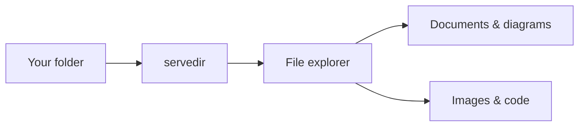

# A place for your next idea

Welcome to **servedir**. This is a small example workspace: a few documents, some code, and a diagram to make yourself at home.

> Everything you need to read this page is bundled into one executable. Try switching off your internet connection.

## From folder to browser



## A few things to try

- Sort files by their name, size, or date.
- Press **/** to find a file in the current folder.
- Open [the field notes](notes/field-notes.md) and follow the link back here.
- Switch between **Preview** and **Source** above.
- Use **Download** to keep the original file.

| File | What you’ll find |
| --- | --- |
| `notes/` | Linked Markdown documents |
| `settings.json` | A syntax-highlighted code preview |
| `landscape.svg` | A local image |

## Made for local work

```fish
servedir --open ~/Documents
```


The server reads this folder as you browse. It doesn’t modify your files or create an index on disk.
